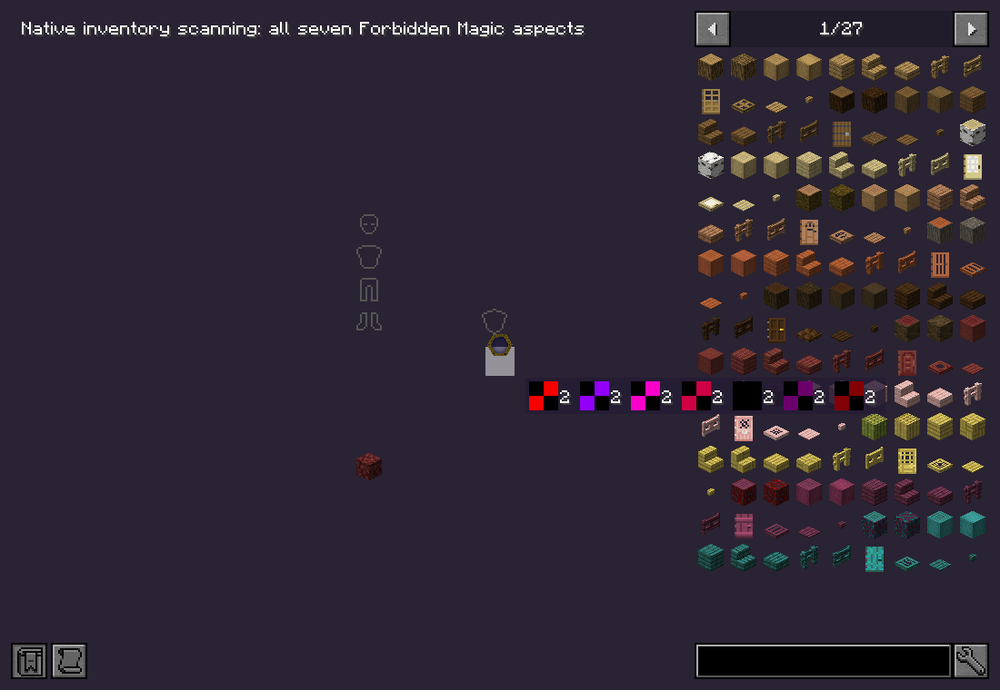
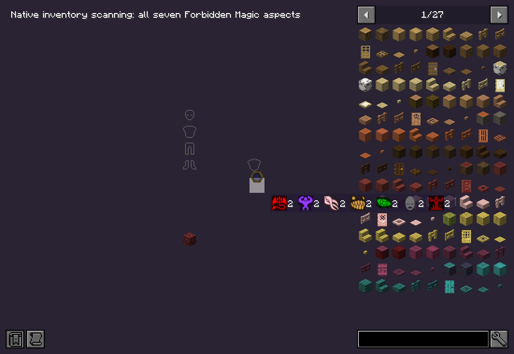

# Issues checked on 2026-10-29

Minecraft 1.21.1, NeoForge 21.1.256, Java 21. Isolated, muted Xvfb clients use fresh copies of the same world. Baseline: TC4Modern 0.17.190 / Thaumic Tinkerer 0.1.13 / Forbidden Magic 0.1.2. Candidate: 0.17.191 / 0.1.14 / 0.1.3.

## Thaumcraft #17: attached eldritch crab cannot be attacked

The native melee selection excludes entities sharing the player's root vehicle unless `canRiderInteract()` allows them. Projectiles similarly exclude the owner's passengers until they leave the owner. An additional vanilla arrow edge case matters here: the arrow starts inside the head crab's collision box inflated by 0.3 blocks, and the entry-only bounding-box ray intersection returns no hit.

The crab permits rider interaction. Projectile filtering makes an exception for a hostile crab attached directly to the shooter. Arrow collision checks this overlapping crab before the normal ray, retaining `canHitEntity` and piercing exclusions. Ordinary passenger protection is retained.

The native audit checks player ray selection followed by `Player.attack`, actual upward `Arrow.tick` damage to the attached crab, exclusion of an ordinary pig passenger, and a hittable unmounted crab. The baseline reproduces failed selection and failed arrow damage.

## Forbidden Magic #1: addon aspects have missing-texture icons

All seven addon textures exist and their registered `Aspect.getImage()` values are correct. Five host drawing paths reconstructed texture paths in the `tc4modern` namespace instead: inventory scanning, the first-person thaumometer, HUD thaumometer, goggles aspect tags, and the deconstruction table. They now use the registered image; undiscovered-aspect markers remain the native unknown texture.

The audit renders all seven addon aspects through native inventory scanning and captures first-person thaumometer and HUD views. It also checks resource lookup and the actual scan target's seven aspect entries. The baseline inventory screenshot displays tinted missing-texture checkerboards despite successful resource lookup.

## Thaumcraft #18: Ifrit's Flame and raw-metal blocks

The affected focus belongs to Thaumic Tinkerer. Its separate 0.1.14 update handles raw iron, gold and copper blocks. Vanilla has no furnace recipes for these storage blocks, so the old focus rejects them. Ordinary smelting recipes retain precedence; no furnace recipes are added by this change.

Native checks cover all three conversions, the twenty-tick warmup, single vis charge, sand-to-glass regression, an empty wand, block entities, and a cancelled protection event with no vis debit.

## Evidence

Laptop audit sources: `compat-test/audit-mod/src/main/java/dev/eugheist/compat/IssuesOct29Audit.java`; runner `compat-test/run-issues29.py`; raw logs, results and screenshots under `compat-test/issues-20261029/{old,new}`. Run `python run-issues29.py old new` from the compatibility workspace. Release jars contain no new test mod classes.

Final result: all 60 native regression/resource checks pass. The old pack reproduces all seven failed combat/conversion observations. Native inventory icon crops have 1–2 distinct colors for missing-texture checkerboards before the fix and 95–180 afterward; all seven icons are visible in the inventory, first-person scanner and offhand HUD. The final client log has no missing addon-aspect texture paths. All 14 Forbidden Magic integration GameTests also pass with the final host and Tinkerer candidates.

The audit source, Gradle run definition and workspace runner are archived under `tests/compat/issues_oct29`. Copy the Java source and init script into the compatibility audit workspace described above before running the archived runner; `TC4_COMPAT_WORKSPACE` can override that workspace path. This harness is separate from the shipped mod.

